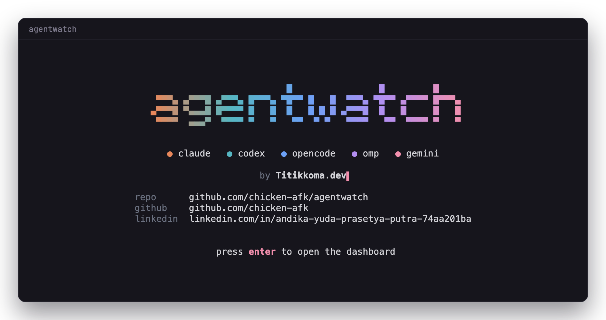
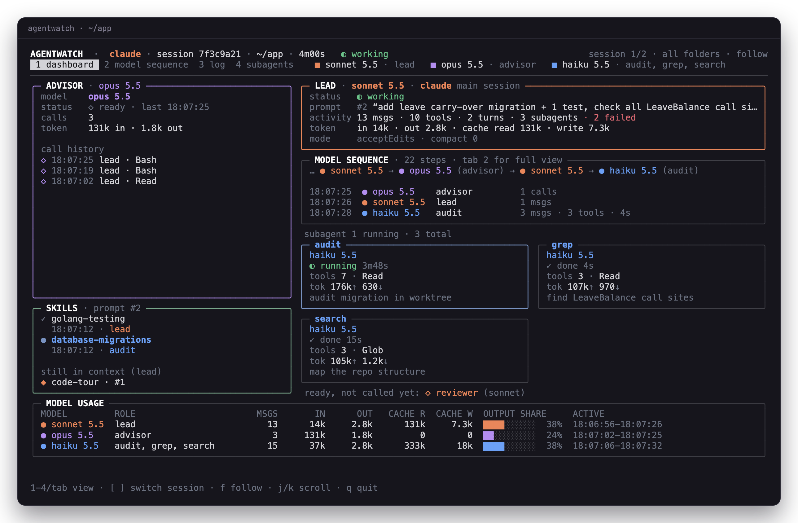
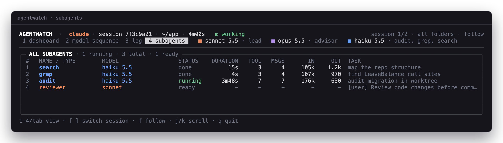

<div align="center">



# agentwatch

**See which model your AI coding agent is actually using, live.**

A terminal dashboard for Claude Code, Codex CLI, Gemini CLI, OpenCode and oh-my-pi:
the lead model, the advisor, every subagent, their skills and their tokens, step by step.

[](https://github.com/chicken-afk/agentwatch/releases)
[](go.mod)


[Install](#install) · [Quick start](#quick-start) · [Supported agents](#supported-agents) · [Usage](#usage) · [How it works](#how-it-works)

</div>

<br>



## Why

Modern coding agents don't run on one model. In a single prompt, Claude Code can hand work to an advisor on a bigger model and to several subagents on smaller ones, and Codex, Gemini CLI, OpenCode and omp all delegate in their own way. The terminal shows none of it: you can't tell which model answered, which subagent ran, or what each step cost.

agentwatch sits in a split next to your agent and shows exactly that, as it happens.

## Features

- **Every model, in order.** Lead, advisor and subagents, with a running model sequence (`sonnet → opus (advisor) → haiku (search) → …`).
- **Subagents at a glance.** Model, status, duration, tool calls, tokens and task for each one, plus configured agents that haven't been called yet.
- **Skills in context.** Which skills were invoked in this prompt, by whom, and which are still loaded from earlier prompts.
- **Token usage per model.** Input, output and cache tokens, and each model's share of the output.
- **One dashboard for every agent.** Claude Code, Codex, Gemini CLI, OpenCode and omp side by side; `[` `]` switches sessions.
- **Folder-aware.** By default it only shows sessions started in the current folder, and follows the most active one.
- **Zero setup for most agents.** It reads the session files the agents already write. Only Claude Code needs a one-time hook install.

## Install

**macOS and Linux** (Intel or Apple Silicon / ARM), no Go needed:

```bash
curl -fsSL https://raw.githubusercontent.com/chicken-afk/agentwatch/main/install.sh | sh
```

The script downloads the latest [release](https://github.com/chicken-afk/agentwatch/releases) for your system, verifies its SHA-256 checksum and installs it to `~/.local/bin`. If that folder isn't on your `PATH`, it prints the one line to add for your shell.

<details>
<summary>Other ways to install</summary>

**With Go** (1.22+):

```bash
go install github.com/chicken-afk/agentwatch@latest
```

The binary goes to `$(go env GOPATH)/bin` (usually `~/go/bin`), which is often not on `PATH` on macOS. If `agentwatch` then says `command not found`:

```bash
echo 'export PATH="$PATH:$HOME/go/bin"' >> ~/.zshrc && . ~/.zshrc
```

**From source:**

```bash
git clone https://github.com/chicken-afk/agentwatch.git && cd agentwatch
go build -o ~/.local/bin/agentwatch .
```

**Install script options:** `AGENTWATCH_INSTALL_DIR=/usr/local/bin` installs elsewhere, `AGENTWATCH_VERSION=v0.1.0` picks a specific release.

</details>

## Quick start

1. **Using Claude Code?** Install its hooks once (other agents need nothing):
   ```bash
   agentwatch install
   ```
2. **Open a split** next to your agent (Ghostty: `Cmd+D` on macOS, `Ctrl+Shift+O` on Linux; or tmux, iTerm2, WezTerm…) and start your agent in one pane.
3. **Run agentwatch** in the other pane, from the same project folder:
   ```bash
   agentwatch
   ```

Press **Enter** on the start screen, and the dashboard follows whichever session in that folder is most active. No agent at hand? `agentwatch demo` plays a recorded Claude Code session.

## Supported agents

| Agent | Read from | Setup |
|---|---|---|
| **Claude Code** | hooks + transcripts in `~/.claude/projects` | `agentwatch install` |
| **Codex CLI** | `$CODEX_HOME/sessions/**/rollout-*.jsonl` (default `~/.codex`) | none |
| **Gemini CLI** | `~/.gemini/tmp/<project>/chats/session-*.json` | none |
| **OpenCode** | `~/.local/share/opencode/storage/` | none |
| **oh-my-pi** (`omp`) | `~/.omp/agent/sessions/<project>/*.jsonl` (and named profiles) | none |
| **Anything else** | events sent to [`agentwatch hook --agent <name>`](#other-tools) | your tool's hook config |

What each one shows:

| | Claude Code | Codex | Gemini CLI | OpenCode | omp |
|---|:-:|:-:|:-:|:-:|:-:|
| Models, prompts, tools, tokens, model sequence | ✓ | ✓ | ✓ | ✓ | ✓ |
| Subagents | ✓ | ✓ | – | ✓ | ✓ |
| Skills | ✓ | ✓ ¹ | ✓ | ✓ | ✓ |
| Advisor | ✓ | – | – | – | – |
| Configured, not-yet-called subagents | ✓ | – | – | – | – |

¹ Codex loads skills by reading their `SKILL.md`; agentwatch records that read as a skill use.

Agents without an advisor get an **AGENT** box in its place, showing the agent, model, folder and the file being read.

## Usage

### Views

| Key | View | Shows |
|:-:|---|---|
| `1` | **Dashboard** | Lead, advisor (or agent info), skills, model sequence, subagent cards, model usage, session log |
| `2` | **Model sequence** | Every model step since the session started, in order |
| `3` | **Log** | Every event: prompts, tool calls, failures, subagent dispatches, advisor calls, compactions |
| `4` | **Subagents** | All subagents in a table, plus configured ones that are still `ready` |



### Keys

| Key | Action |
|---|---|
| `1`–`4`, `Tab`, `Shift+Tab` | Switch view |
| `]` / `[` (or `n` / `p`) | Next / previous session |
| `f` | Follow the most active session again |
| `j` `k`, `↓` `↑`, mouse wheel | Scroll |
| `PgUp` `PgDn`, `g` `G` | Scroll by page, to top / bottom |
| `q`, `Ctrl+C` | Quit |

### Commands

| Command | What it does |
|---|---|
| `agentwatch` | Open the dashboard (same as `agentwatch watch`) |
| `agentwatch install` | Install the Claude Code hooks and skill rules (`--statusline`, `--no-rules`) |
| `agentwatch uninstall` | Remove the hooks, status line and skill rules |
| `agentwatch update` | Update to the latest release (`--check`, `--force`, `--source`) |
| `agentwatch version` | Show the version and the commit it was built from |
| `agentwatch demo` | Play a recorded session, no agent needed |
| `agentwatch rules` | Install, show (`--show`) or remove (`--remove`) only the skill rules |
| `agentwatch hook --agent <name>` | Receive events from another tool on stdin |

### Options

| Flag | Default | Description |
|---|---|---|
| `--all` | off | Show sessions from every folder |
| `--dir <path>` | current folder | Only show sessions in this folder and its subfolders |
| `--agent <names>` | all | Only these agents: `claude`, `codex`, `gemini`, `opencode`, `omp`, or a hook name (comma-separated) |
| `--session <id>` | – | Pin one session (an id prefix is enough); disables the folder filter |
| `--window <dur>` | `24h` | How far back to load Codex, Gemini, OpenCode and omp sessions |
| `--recent <dur>` | – | Also show Claude Code transcripts active within this time, even without hooks |
| `--advisor <model>` | – | Advisor label when it can't be read from settings, globally or per session (`<id>=<model>`) |
| `--no-splash` | off | Skip the start screen |

### Environment variables

| Variable | Description |
|---|---|
| `AGENTWATCH_NO_SPLASH=1` | Skip the start screen |
| `AGENTWATCH_DIR` | Where Claude Code hook events are stored (default `~/.claude/agentwatch`) |
| `CLAUDE_CONFIG_DIR` | Claude Code's config folder (default `~/.claude`) |
| `CODEX_HOME` | Codex home (default `~/.codex`) |
| `AGENTWATCH_GEMINI_DIR` | Gemini CLI home (default `~/.gemini`) |
| `AGENTWATCH_OPENCODE_DIR` | OpenCode data folder (default `$XDG_DATA_HOME/opencode` or `~/.local/share/opencode`) |
| `AGENTWATCH_OMP_DIR` | omp home (default `~/.omp`) |
| `AGENTWATCH_SRC` | Clone used by `agentwatch update --source` |

## Claude Code integration

`agentwatch install` adds agentwatch's hooks to `~/.claude/settings.json`. Your existing hooks and settings are kept, and a backup is made whenever the file actually changes. Start a new Claude Code session afterwards so the hooks take effect. `agentwatch uninstall` removes everything again.

- **Status line** (`--statusline`): shows the lead and advisor models under the Claude Code prompt. It is only installed if you don't already have a status line.
- **Skill rules:** `install` also adds a short block to `~/.claude/CLAUDE.md`, which Claude Code loads in every project. It asks Claude to actually invoke skills through the Skill tool and to report only the skills it invoked, so what Claude says matches the SKILLS box. Skip it with `--no-rules`, or manage it with `agentwatch rules`.

<details>
<summary>Advisor labels</summary>

The advisor's model is read from the transcript once the advisor has been called, otherwise from `advisorModel` in Claude Code's settings. If you start Claude with `claude --advisor opus` (a flag, not a setting), tell agentwatch:

```bash
agentwatch --advisor opus                              # every session
agentwatch --advisor 7f3c=opus --advisor 9c1b=sonnet   # per session (id prefix, repeatable or comma-separated)
agentwatch --session 7f3c --advisor opus               # pin a session and label only that one
```

Priority: the transcript, then a per-session label (longest prefix wins), then the global label, then `advisorModel` from `~/.claude/settings.json`, `<project>/.claude/settings.json` and `<project>/.claude/settings.local.json`.

</details>

## Other tools

Any tool that can run a command on an event can feed the dashboard. Send one JSON object per event on stdin, using Claude Code's hook field names:

```bash
echo '{"session_id":"s1","cwd":"'"$PWD"'","hook_event_name":"UserPromptSubmit","prompt":"add tests","model":"gpt-5"}' \
  | agentwatch hook --agent aider
```

| `hook_event_name` | Fields |
|---|---|
| `SessionStart`, `SessionEnd` | `model`, `cwd` |
| `UserPromptSubmit` | `prompt` |
| `PreToolUse`, `PostToolUse`, `PostToolUseFailure` | `tool_name`, `tool_input`, `error` |
| `Message` | one model reply: `model`, `input_tokens`, `output_tokens`, `cache_read_tokens` |
| `Stop` | the turn finished |
| `SubagentStart`, `SubagentStop` | `agent_id`, `agent_type` |

Every event needs a `session_id`, and `cwd` is used for the folder filter. Gemini-style names (`BeforeTool`, `AfterTool`, `BeforeAgent`, `AfterAgent`, `PreCompress`) are accepted too. Use your own agent name: Codex, Gemini, OpenCode and omp are already read from their files.

## How it works

- **Claude Code:** its hooks call `agentwatch hook`, which appends a slimmed-down copy of each event to `events.jsonl` (it never writes to stdout and always exits 0, so it can't get in Claude's way). The dashboard also tails the session and subagent transcripts, which hold the model of every message, the token counts and the advisor calls.
- **Codex and omp:** their session logs are append-only JSONL, so agentwatch tails them line by line, subagent threads and workers included.
- **Gemini CLI and OpenCode:** they rewrite JSON files, so a session is rebuilt whenever one of its files changes.
- Sessions from all agents end up in one list, filtered by folder and sorted by activity. A session still marked as working whose files have been quiet for 5 minutes is shown as idle.

<details>
<summary>Skills, in detail</summary>

Skills are recorded from Skill tool calls (lead and subagents) and from slash commands you type (`/name args`, except built-ins like `/clear` or `/model`). The first word after the name is read as a subcommand: `/impeccable layout page` shows as `impeccable layout`.

Skills the lead invoked in earlier prompts are listed as **still in context**, because their instructions stay in the lead's context for the rest of the session (Claude Code even re-attaches them after a compaction). Skills invoked by a subagent only live in that subagent, so they appear as **subagent history**. "In context" means the instructions are available, not that they were followed in this prompt; only the skills at the top were invoked in the current one.

</details>

## Updating

```bash
agentwatch update           # download the latest release, verify it, replace the binary in place
agentwatch update --check   # only check
```

The binary keeps its path, so installed hooks keep working; restart open dashboards to use the new version. `--source` builds the latest `main` instead (needs git and Go), `--branch <name>` another branch, and `--src <folder>` your own checkout.

<details>
<summary>Upgrading from ccwatch</summary>

agentwatch used to be called **ccwatch**. Run `ccwatch update` once, then `agentwatch install`. The first run renames the binary to `agentwatch` (leaving `ccwatch` as a symlink), repoints the existing hooks and status line, and swaps the old skill-rules block for the new one. Old `CCWATCH_*` environment variables still work, and events from Claude sessions still running on the old hooks are still read.

</details>

## Limitations

- **Session formats aren't official APIs.** Claude Code transcripts and the session files of Codex, Gemini CLI, OpenCode and omp can change between versions. If an agent's numbers go blank after an update, its format most likely changed; the other agents keep working.
- **Verified against real sessions:** Claude Code and omp. Codex, Gemini CLI and OpenCode are built from their published formats and tested with sample files.
- **Gemini CLI:** older versions name project folders by a hash of the path, which agentwatch can only match against the folder it runs in (use `--all` to see the rest). Antigravity's binary format isn't supported.
- **OpenCode:** only the JSON file storage is read, not a database.
- **omp:** its advisor isn't shown yet, since its format hasn't been observed.
- **Configured subagents** (`.claude/agents`) are only available to Claude; it decides when to delegate. If one stays `ready`, ask for it by name.

## Development

```bash
go vet ./... && go test ./...      # checks
go run . demo                      # try the dashboard with a recorded session
```

| Package | Responsibility |
|---|---|
| `internal/cli` | Subcommands and flags |
| `internal/store` | Session state from hook events and each agent's session files (`codex.go`, `gemini.go`, `opencode.go`, `omp.go`) |
| `internal/ui`, `internal/theme` | Bubble Tea dashboard, start screen and colors |
| `internal/install` | Hooks, status line and skill rules in Claude Code's config |
| `internal/hook`, `internal/events`, `internal/statusline` | `agentwatch hook` / `statusline` and `events.jsonl` |
| `internal/update` | `agentwatch update` from releases or source |
| `internal/demo` | The recorded session behind `agentwatch demo` |

**Releases:** push a version tag (`git tag v0.2.0 && git push origin v0.2.0`). GitHub Actions builds macOS and Linux binaries with GoReleaser and publishes them with `checksums.txt`.

## Author

Made by **[Titikkoma.dev](https://github.com/chicken-afk)**. Find me on [GitHub](https://github.com/chicken-afk) and [LinkedIn](https://www.linkedin.com/in/andika-yuda-prasetya-putra-74aa201ba/). Feedback and agent requests are welcome in [issues](https://github.com/chicken-afk/agentwatch/issues).
